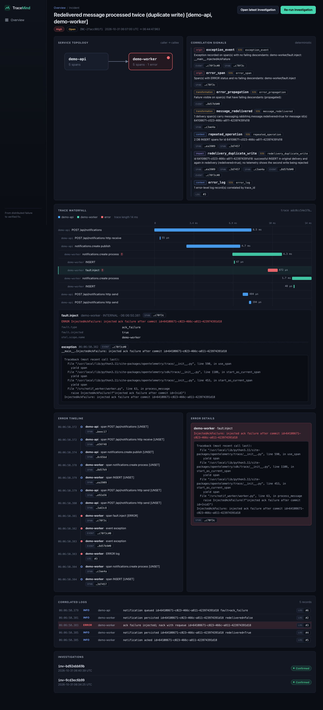
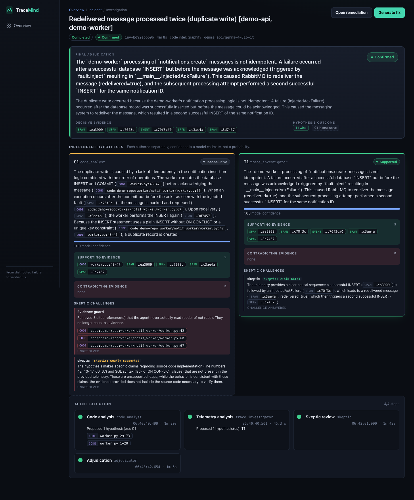
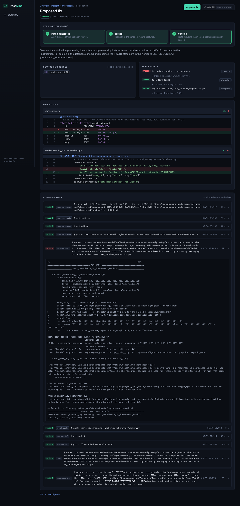
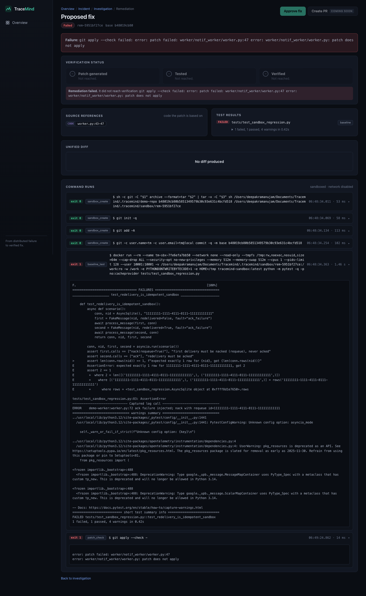
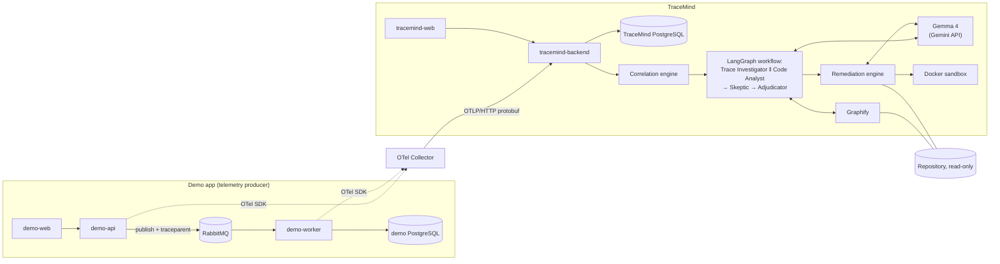

# TraceMind

### From distributed failure to verified fix.

    

TraceMind is an open-source AI incident investigation and remediation tool. It connects **OpenTelemetry runtime evidence**
(traces and logs) to **source-code analysis**, generates a targeted fix, and **validates it with regression tests in an
isolated Docker sandbox**. Several model-backed agents form and challenge root-cause hypotheses, and every claim they make
must point at a stored span, log or real source lines.

The problem is a familiar one. When a failure crosses services, queues and retries, an engineer has to correlate traces,
logs, message redeliveries, service dependencies and code by hand, then implement a fix and prove it did not break
anything. TraceMind automates the legwork and keeps the proof. The monitored application needs **no TraceMind SDK**:
anything that exports standard OTLP/HTTP (protobuf) traces and logs can be investigated.

> Hackathon MVP, now hardened for small trusted-team use (auth, rate limiting, redaction, non-root, pinned deps). It works end to end on one deterministic incident and is **not yet production-ready**: see [docs/PRODUCTION_READINESS.md](docs/PRODUCTION_READINESS.md) for the remaining work and [Limitations](#limitations).

## Project at a glance

| | |
|---|---|
| **Repository** | https://github.com/deepakramanujam321-spec/Tracemind (MIT) |
| **How to run it** | **Locally with Docker Compose.** There is no hosted deployment and no live URL. A full-stack Cloudways deployment is not supported by the current environment (the stack needs Docker, PostgreSQL and RabbitMQ; see [docs/DEPLOYMENT.md](docs/DEPLOYMENT.md)). |
| **Demo** | There is no recorded demo video. **The local quickstart below is the demo**: about five minutes, and the first four steps need no model API key. |
| **Stack** | React + TypeScript, Python / FastAPI, PostgreSQL, RabbitMQ, OpenTelemetry + Collector, LangGraph, Gemma 4, Graphify, Docker Compose (badges above) |
| **See it first** | [Screenshots](#screenshots) of real runs, then the [architecture diagram](#architecture) |
| **Deeper docs** | [Architecture](docs/ARCHITECTURE.md) · [Security](docs/SECURITY.md) · [Limitations](docs/LIMITATIONS.md) · [Models](docs/models.md) · [Deployment assessment](docs/DEPLOYMENT.md) · [Contributing](CONTRIBUTING.md) |

### Try it in five minutes

```bash
git clone https://github.com/deepakramanujam321-spec/Tracemind.git && cd Tracemind
cp .env.example .env                  # placeholders work as-is; set POSTGRES_PORT if 5432 is taken
docker compose up -d --build          # first build takes a few minutes; everything binds to 127.0.0.1
./scripts/reproduce_incident.sh       # fires the deterministic fault: prints "DUPLICATE REPRODUCED"
```

Then open **http://localhost:5174**, press **Run detection**, and open the incident: topology, deterministic signals, trace waterfall
and logs, rebuilt from the OpenTelemetry data the demo app just emitted. Running the AI investigation and the sandboxed fix needs a
Gemma API key in `.env` (and the opt-in remediation overlay); see [Quickstart](#quickstart) for those steps.

## How it works

**Observe → Reconstruct → Investigate → Challenge → Locate → Fix → Verify**

| Step | What happens |
|---|---|
| **Observe** | The app exports standard OTLP traces and logs through an OpenTelemetry Collector; TraceMind stores them in PostgreSQL. |
| **Reconstruct** | A deterministic correlation engine rebuilds the trace tree, service edges, error spans, redeliveries and duplicate writes, and states explicitly what telemetry is missing. |
| **Investigate** | The Trace Investigator and the Code Analyst each form a hypothesis independently, so one cannot anchor the other. |
| **Challenge** | A Skeptic tries to refute both hypotheses. An Adjudicator returns *supported*, *rejected* or *inconclusive*. |
| **Locate** | Graphify-assisted code analysis ranks candidate files and symbols; every cited line range is re-checked against the real file. |
| **Fix** | The model proposes exact search/replace edits; TraceMind applies them to an isolated copy of the repo and derives the diff. |
| **Verify** | Tests run in a locked-down Docker sandbox, baseline versus after the patch. |

**The differentiator:** TraceMind never reports a fix as `verified` unless the sandbox tests actually passed.

## Screenshots

| | |
|---|---|
|  |  |
| **Incident:** topology, signals, trace waterfall and logs reconstructed from telemetry. | **Investigation:** agent steps, both hypotheses, the skeptic's challenges and the adjudication. |
|  |  |
| **Remediation, verified:** the diff, each command with its exit code, and baseline versus after-patch results. | **Remediation, not verified:** a run whose fix did not verify. The UI shows the failure instead of claiming success. |

## Architecture



The demo app emits traces and logs, propagating W3C trace context through RabbitMQ message headers. The Collector batches
them and forwards OTLP to the TraceMind backend, which stores and correlates them. An investigation reads the incident
context and the source code and returns evidence-backed hypotheses. The remediation engine applies a model-proposed edit to
an **isolated copy** of the repository at the recorded commit and runs the tests in a container with no network. Full
contract: [docs/ARCHITECTURE.md](docs/ARCHITECTURE.md).

Stack: React + TypeScript (Vite), Python 3.11+ / FastAPI, PostgreSQL 16, RabbitMQ 3.13, OpenTelemetry (Python SDK,
Collector contrib 0.116.1), LangGraph, Gemma 4, Graphify, Docker Compose.

## Why TraceMind is different

1. **Standard OTLP.** No proprietary agent or SDK in the monitored app.
2. **Evidence-backed reconstruction.** Signals come from deterministic code over stored spans and logs, not from a model's guess.
3. **Independent hypotheses.** Trace and code analysis are formed separately, then compared.
4. **A skeptic.** A dedicated agent tries to refute the hypotheses before anything is accepted.
5. **An adjudicator that can say no.** It can reject, or return *inconclusive*, when the evidence does not support a root cause.
6. **Graphify-assisted code investigation.** An AST code graph narrows where to look; cited lines are re-validated against real files.
7. **Sandboxed remediation.** Patches run on a copy of the repo in an unprivileged container with `--network none`.
8. **Verification only from real test results.** `verified` is set from sandbox test exit codes, never from model output.
9. **No automatic production modification.** Nothing is merged or pushed; the original repository is only ever read.

A root-cause explanation is useful. A fix with verified regression tests is more useful.

## Hackathon technology integration

### Gemma 4

Gemma 4 does the model work at every reasoning step:

| Role | Used for |
|---|---|
| Trace Investigator | Independent hypothesis from runtime evidence |
| Code Analyst | Independent hypothesis from source code |
| Skeptic | Challenges both hypotheses |
| Adjudicator | Final supported / rejected / inconclusive verdict |
| Remediation | Generates the code edits |

- Live-verified with `gemma-4-31b-it` through the Gemini API `generateContent` endpoint.
- Structured output is JSON-in-prompt with Pydantic validation and bounded retry; thinking parts are dropped from returned text.
- Timeout (`MODEL_TIMEOUT_S`) and thinking level (`MODEL_THINKING_LEVEL`) are configurable.
- An OpenAI-compatible local provider (`gemma_local`, for Ollama-style servers) is **implemented but not live-tested**.
- Tool calling is **not implemented**.

Details: [docs/models.md](docs/models.md).

### Graphify

Installed from PyPI as `graphifyy`. The backend builds an AST-only code graph with `graphify extract --code-only` and queries
it to rank candidate symbols and files for the Code Analyst. Every cited line range is then re-validated against real file
contents. If Graphify is unavailable, a clearly labelled plain-source fallback is used, and the UI and API report
`code_backend` as `graphify` or `fallback`. In our live run it reported `graphify`. Graphify helps locate code; it does not
prove a root cause.

### Cloudways

We researched Cloudways ([docs/DEPLOYMENT.md](docs/DEPLOYMENT.md)). The full stack needs Docker, PostgreSQL and RabbitMQ, which
the researched Cloudways environment does not document as available. **We did not deploy there and make no deployment claim.**
The validated submission environment is Docker Compose. At most, the static frontend could be hosted on Cloudways.

### Open-source AI

Public repository under the MIT license. Standard OTLP in, documented contracts ([docs/](docs/)), evidence references that
resolve to real records, a deterministic reproducible incident, testable remediation, and a [CONTRIBUTING.md](CONTRIBUTING.md).

## Quickstart

Prerequisites: Docker with Compose v2, Git, ~6 GB free disk, and a Gemini API key with access to Gemma 4 (needed only for
investigation and remediation; ingestion, correlation and the UI work without it).

```bash
git clone https://github.com/deepakramanujam321-spec/Tracemind.git
cd Tracemind
cp .env.example .env          # .env is git-ignored; never commit it
```

Edit `.env`:

| Variable | Set to |
|---|---|
| `POSTGRES_PASSWORD` | any local password (also update the password inside `APP_DATABASE_URL` and `TRACEMIND_DATABASE_URL` to match) |
| `MODEL_PROVIDER` | `gemma_api` |
| `MODEL_NAME` | `gemma-4-31b-it` (or `gemma-4-26b-a4b-it`) |
| `MODEL_API_KEY` | your key (only ever in `.env`) |
| `POSTGRES_PORT` | change from 5432 if that host port is already in use |

Start the stack (first build takes a few minutes):

```bash
docker compose up -d --build
docker compose ps             # all services should be Up / healthy
```

All ports are bound to `127.0.0.1` only:

| URL | What |
|---|---|
| http://localhost:5174 | **TraceMind dashboard** |
| http://localhost:8100/docs | TraceMind API (OpenAPI) |
| http://localhost:5173 | Demo notification app |
| http://localhost:8000 | Demo API |
| http://localhost:15672 | RabbitMQ management (credentials from `.env`) |
| http://localhost:4318 | OTLP/HTTP (Collector) |

### 1. Reproduce the incident

```bash
./scripts/reproduce_incident.sh
```

It posts one notification with the fault flag and prints the inbox. Expected: `DUPLICATE REPRODUCED` (one logical
notification, two inbox rows). You can also tick "Inject ack-failure" in the demo app at :5173.

### 2. Reconstruct and investigate

Open http://localhost:5174, then:

1. **Run detection.**
2. Open the incident (topology, signals, trace waterfall, logs).
3. **Start investigation.** This calls Gemma and takes a few minutes.

The Investigation page shows the agent steps, both hypotheses, the skeptic's challenges, the evidence guard's rejections and
the adjudication. Click any reference chip to resolve it to the real span, log or source lines.

### 3. Remediate (opt-in, needs the Docker socket)

Remediation runs tests in sibling containers, so it needs a separate overlay that mounts the Docker socket into the backend.

> **Warning:** the Docker socket is root-equivalent on the host. Use this overlay only on a trusted dev machine
> ([docs/SECURITY.md](docs/SECURITY.md)).

```bash
./scripts/prepare_demo_repo.sh        # snapshot demo/ into .tracemind/demo-repo (the repo TraceMind investigates)
./scripts/build_sandbox_image.sh      # the only networked step; tests later run with --network none
echo "TRACEMIND_HOST_ROOT=$PWD" >> .env
docker compose -f docker-compose.yml -f docker-compose.remediation.yml up -d --build
curl -s -XPOST localhost:8100/api/repositories -H 'content-type: application/json' \
  -d "{\"path\":\"$PWD/.tracemind/demo-repo\",\"name\":\"demo-notifications\"}"
```

> **Keep passing both `-f` files** (or `export COMPOSE_FILE=docker-compose.yml:docker-compose.remediation.yml`) on every later
> `docker compose` command. A plain `docker compose up` recreates the backend from the default file, which silently drops the
> overlay (no Docker socket, no repo mount). Registration is restricted to `TRACEMIND_REPO_ROOTS`; a path outside it (for example
> `/etc`) is rejected. The sandbox only runs the offline-capable tests listed in `TRACEMIND_SANDBOX_SUITE`.

Then run the investigation (step 2) and press **Generate fix** on the Investigation page. The Remediation page shows the
diff, every command with its exit code, baseline versus after-patch test results, and the status.

### Whole lifecycle in one command

```bash
./scripts/e2e_lifecycle.sh
```

Triggers the failure, detects the incident, investigates, remediates, asserts the status is `verified`, and checks the source
repository is byte-identical afterwards. It makes real model calls (minutes, uses quota).

## The incident TraceMind solves

The demo is an in-app notification platform: React → FastAPI → RabbitMQ → worker → PostgreSQL.

1. The API publishes a notification message to RabbitMQ.
2. The worker consumes and processes it.
3. The worker commits the notification row to the database.
4. A deterministic fault (`x-fault: ack_failure`, honoured only when `FAULT_INJECTION_ENABLED=true`, only for the selected
   message, only on first delivery) makes the worker fail **after the commit and before the ack**, and it nacks with requeue.
5. RabbitMQ redelivers the message.
6. The baseline has no idempotency (no unique constraint, a plain `INSERT`), so the redelivery inserts a second row: one
   logical notification, two inbox rows. This bug is intentional and is the investigation target.

**Expected fix:** a `UNIQUE` constraint on `notification_id`, `INSERT ... ON CONFLICT (notification_id) DO NOTHING`, and a
regression test.

**What TraceMind sees:** a producer span, a consumer span with an exception event, `messaging.rabbitmq.message.redelivered=true`
on the second delivery, and two successful INSERT spans for the same `notification.id`. The correlation engine reports these
as signals (`exception_event`, `message_redelivered`, `redelivery_duplicate_write`, ...) with evidence references. The agents
reason over those signals and over the worker source, found through Graphify. In our live run the adjudication was `confirmed`
(ack failure after commit plus missing idempotency). The generated fix added `UNIQUE` and `ON CONFLICT DO NOTHING`, and the
regression test passed in the sandbox.

**Baseline versus fixed are kept separate.** The baseline code stays faulty until a remediation is applied. The spec for the
fix is `demo/tests/test_redelivery.py::test_redelivery_is_idempotent` (needs Postgres and RabbitMQ) and its offline twin
`demo/tests/test_sandbox_regression.py::test_redelivery_is_idempotent_sandbox` (SQLite and a fake message, runs in the
sandbox). Both carry the `injected_bug` marker, **fail at the baseline by design**, and must pass after the fix. They are never
skipped or xfailed, because an xfail would exit 0 and fake a verification. That baseline failure is a reproduction spec; the
post-fix regression result is what decides `verified`.

## Security and trust

Implemented today (details and gaps in [docs/SECURITY.md](docs/SECURITY.md)):

- Secrets only via environment; `.env` and `.env.*` are git-ignored, `.env.example` holds placeholders. Compose refuses to start
  without `POSTGRES_PASSWORD`. No secret is passed to the frontend or baked into images. We scanned tracked files and git
  history for credential patterns and found none.
- All published ports bind to `127.0.0.1`.
- Telemetry, logs and repository text are treated as **untrusted data**: delimited in prompts, forged delimiters neutralised,
  and an evidence guard rejects references the agents did not actually have (prompt-injection test included).
- Repository access is path-confined (no `..`, no symlink escape, no `.git`); registration can be restricted with `TRACEMIND_REPO_ROOTS`.
- Patches are validated before use; the original repository is only ever read. Sandbox containers: not privileged, all
  capabilities dropped, `no-new-privileges`, read-only root and source mount, `--network none`, CPU/memory/pid limits, non-root
  user, no host environment, hard timeout. **Probed on a live container** (see Testing).
- Nothing is merged or pushed automatically. "Human approval" means the explicit approve action on a verified remediation; PR
  creation is not implemented.

Known risks, stated plainly:

- **No authentication or authorization** on the TraceMind API or OTLP endpoints. Do not expose them publicly.
- **Docker socket:** the remediation overlay is opt-in because the socket is root-equivalent. Docker isolation shares the host
  kernel and is not a production-grade sandbox boundary.

## Scalability

Implemented knobs (environment variables, see `.env.example`):

| Dimension | Mechanism |
|---|---|
| DB connections | `TRACEMIND_DB_POOL_MAX` per backend process; DB sessions are held only per statement, never across slow model calls |
| Concurrent LLM jobs | `TRACEMIND_MAX_CONCURRENT_JOBS` (bounded semaphore); model timeout `MODEL_TIMEOUT_S`; bounded retries on timeouts/429/5xx only |
| Queue consumers | `WORKER_PREFETCH`; the demo worker acks only after commit; redelivery is the scenario being studied |
| Telemetry buffering | Collector `memory_limiter` + `batch`; ingest bodies capped at 32 MiB; OTLP retry on 503 |
| Resources | `BACKEND_MEM_LIMIT`, `COLLECTOR_MEM_LIMIT`; incident queries are time-bounded (`window_hours`) and per-trace |

**Vertical:** give the backend, Postgres and Collector more CPU/RAM, then raise the pool and job limits together, keeping
`replicas × pool` below Postgres `max_connections`.

**Horizontal (architectural path, not load-tested):** durable state (telemetry, incidents, investigations, hypotheses,
remediations) lives in PostgreSQL, so several backend replicas can share one database behind a load balancer; job rows are
age-reaped, not owner-tracked. Workers are plain RabbitMQ consumers and can be run in multiples (`docker compose up -d --scale
demo-worker=N` is untested).

**Not implemented / known gaps:** investigation jobs run in in-process threads (not a durable queue; a replica crash abandons
its jobs until the reaper fails them), and the Docker-socket overlay ties remediation to one host. We have **no throughput or
load-test numbers** and do not claim any.

## Testing and verification

```bash
./scripts/test_all.sh
```

Runs the backend suite (ingest, store, correlation, investigation, models, code, remediation including a real Docker sandbox),
the frontend build, the demo integration tests (throwaway Postgres/RabbitMQ containers), and then asserts the `injected_bug`
specs **fail** at the baseline. Optional live-model test: `MODEL_API_KEY=... pytest tests/test_models.py -k live`. The
end-to-end lifecycle script is described in the Quickstart.

Final runs on the submitted code (2026-10-31). Status words: VERIFIED = we ran it and saw this output.

| Check | Command | Result |
|---|---|---|
| Backend suites: ingest, store, correlation, investigation (scripted model), models, code intelligence, remediation incl. **real Docker sandbox**, API service (repo-root allowlist, stale-job reaper) | `./scripts/test_all.sh` | **89 passed, 1 skipped.** The skip is the opt-in live-Gemma test (needs `MODEL_API_KEY`); it passed when run with a key: `pytest tests/test_models.py -k live` -> 1 passed. VERIFIED |
| Demo integration tests (throwaway Postgres + RabbitMQ, `REQUIRE_SERVICES=1` so an unreachable service **fails** instead of skipping) | `./scripts/test_all.sh` | **5 passed, 0 skipped.** VERIFIED |
| Injected-bug specs (`-m injected_bug`): `test_redelivery_is_idempotent` and its offline twin | `./scripts/test_all.sh` | **2 failed at the baseline, by design** (the duplicate reproduces). The script asserts they fail; after a fix they must pass (`EXPECT_FIXED=1`). Never skipped or xfailed. VERIFIED |
| Frontend | `cd tracemind/web && npm ci && npm run build` (also run by the web Docker image build) | `tsc -b && vite build`, zero TypeScript errors. VERIFIED |
| Dashboard against the real backend | headless Chrome (Playwright) over Overview, Incident, Investigation, Remediation, evidence drawer, loading/error/empty states, verified/tested/failed remediations | no console errors apart from intentional 404 tests. VERIFIED |
| Whole lifecycle, live Gemma 4 | `./scripts/e2e_lifecycle.sh` | duplicate reproduced -> incident detected from OTLP telemetry -> investigation (`code_backend: graphify`, certainty `confirmed`) -> patch (`UNIQUE` on `notification_id` + `ON CONFLICT (notification_id) DO NOTHING`) applied in the sandbox copy -> baseline test **failed (exit 1)**, after-patch suite **passed (exit 0)**, regression **passed (exit 0)** -> status `verified`; source repository byte-identical afterwards. `LIFECYCLE OK`, exit 0. VERIFIED |

**Negative paths (real demo repo, real Docker sandbox, in the backend suite):** a comment-only patch, an `ON CONFLICT` without the unique index, an
unrelated edit, and a patch that fixes the scenario but breaks another test all end `tested`, never `verified`. A non-diff, a diff that
does not apply, and diffs touching `../`, `.git`, or absolute paths are rejected (`failed` / no patch). A test that collects nothing does
not count as a pass. A timeout kills the container (`exit_code: null`, reported as such) and leaves none behind. The source tree hash was
unchanged in every case. VERIFIED.

**Sandbox container probe** (`docker inspect` / `docker exec` on a live sandbox): not privileged, all capabilities dropped, `no-new-privileges`,
read-only root and read-only source mount, no host environment variables, `--network none` (a connect attempt fails), 512 MiB / 1 CPU /
128 pids, runs as uid 10001. VERIFIED.

**Honest failure behavior, observed:** during development a remediation reported `failed` with the real error when (a) the model call timed
out, (b) the model's unified diff did not apply (`git apply --check` failed; this is why patches are now search/replace edits), and
(c) the backend container lacked the Docker CLI. Each was surfaced as `failed` instead of a success claim.

**Not verified:** multi-replica operation, `docker compose up --scale demo-worker=N`, throughput/load, the local (Ollama-style) model provider,
GitHub PR creation (not implemented), metrics ingestion (not implemented), any Cloudways deployment.

## Limitations

Full table: [docs/LIMITATIONS.md](docs/LIMITATIONS.md). In short:

- No authn/authz, single tenant, no TLS or rate limiting, not load-tested.
- Results depend on model quality and on API availability and cost; telemetry is sent to the model provider with no redaction.
- Traces and logs only (no metrics); no GitHub PR creation; tool calling is not implemented.
- Correlation signals were built around the demo scenario; generality to other failure classes is untested.
- Investigation jobs are in-process threads; in-flight jobs are lost on restart and reaped as failed later.
- The sandbox runs with no network, so only offline tests can run there.
- Docker isolation is not a production boundary.
- Cloudways: no deployment was performed (see above).

## Contributing & license

See [CONTRIBUTING.md](CONTRIBUTING.md). Report bugs via GitHub issues; report vulnerabilities privately as described in
[docs/SECURITY.md](docs/SECURITY.md). Layout: `demo/` (telemetry producer with the injected bug), `tracemind/backend`
(ingest, store, correlation, investigation, models, code, remediation, API), `tracemind/web` (dashboard), `infra/`
(Collector, Postgres init), `scripts/`, `docs/`. License: [MIT](LICENSE).
