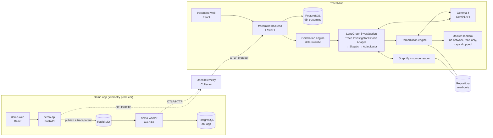

# TraceMind

**From distributed failure to verified fix.**

TraceMind is an open-source incident-investigation tool. It ingests standard **OpenTelemetry** traces and logs,
reconstructs what happened across services, has several AI agents investigate competing root-cause hypotheses
(with a skeptic that tries to refute them), connects the runtime evidence to the **source code**, proposes a patch,
and **tests that patch in an isolated Docker sandbox**. A human reviews the result. Nothing is merged automatically.

> Hackathon MVP. It works end to end on one deterministic incident and is **not production-ready**.
> Read [Limitations](#limitations) before judging claims. Status words used below:
> **VERIFIED** = we ran it and have the output, **IMPLEMENTED** = code exists but the full workflow was not validated,
> **NOT IMPLEMENTED** = does not exist.

## Why

A modern failure spans services, queues, retries and redeliveries. Engineers correlate traces, logs and code by hand,
guess a cause, then hope the fix works. TraceMind connects *runtime evidence* to *source code* to *a tested fix*,
and it is built to say **"inconclusive"** rather than assert a root cause the evidence does not support.

TraceMind needs **no TraceMind-specific SDK** in the monitored application: any app that exports OTLP/HTTP
(protobuf) traces and logs can be investigated.

## What it does

| Capability | Status |
|---|---|
| OTLP/HTTP protobuf ingestion of traces and logs, normalised into PostgreSQL (JSONB attributes preserved) | VERIFIED |
| Deterministic correlation: trace tree, service edges, error/exception spans, log correlation, redelivery and duplicate-write detection, explicit "limitations" when telemetry is missing | VERIFIED |
| Multi-agent investigation (LangGraph): Trace Investigator and Code Analyst form hypotheses **independently**, a Skeptic challenges them, an Adjudicator returns supported / rejected / inconclusive | VERIFIED live with Gemma 4 |
| Evidence guard: every cited reference (`span:`, `event:`, `log:`, `sig:`, `code:`) must resolve to a stored record or real source lines, otherwise it is stripped and flagged | VERIFIED |
| Graphify-assisted code discovery (AST graph), with a clearly labelled plain-source fallback | VERIFIED (Graphify backend used in live run) |
| Patch generation (model proposes exact search/replace edits; TraceMind derives the diff) | VERIFIED live |
| Isolated sandbox test run, statuses `patch_generated` → `tested` → `verified` (or `failed`) | VERIFIED |
| React dashboard: Overview, Incident, Investigation, Remediation | VERIFIED against the real backend (headless Chrome) |
| Metrics ingestion | NOT IMPLEMENTED |
| GitHub pull-request creation | NOT IMPLEMENTED |
| Authentication / multi-tenancy | NOT IMPLEMENTED |


## Architecture



Data flow: the demo app emits traces and logs (W3C trace context is propagated through RabbitMQ headers) →
the Collector batches them → TraceMind stores and correlates them → an investigation reads the incident context,
inspects source code, and returns evidence-backed hypotheses → the remediation engine applies a model-proposed edit to
an **isolated copy** of the repository at the recorded commit and runs the tests in a locked-down container.
The full contract is in [docs/ARCHITECTURE.md](docs/ARCHITECTURE.md).

## Technology stack

React + TypeScript (Vite) · Python 3.11+ / FastAPI · PostgreSQL 16 · RabbitMQ 3.13 · OpenTelemetry (Python SDK,
Collector contrib 0.116.1, OTLP/HTTP) · LangGraph · Gemma 4 via the Gemini API (provider abstraction; an OpenAI-compatible
local provider such as Ollama is IMPLEMENTED but not live-tested) · Graphify (`graphifyy` on PyPI) · Docker / Docker Compose.

## Quickstart

Prerequisites: Docker with Compose v2, Git, ~6 GB free disk, and a Gemini API key with access to Gemma 4
(only needed for the investigation and remediation steps; ingestion, correlation and the UI work without it).

```bash
git clone https://github.com/deepakramanujam321-spec/Tracemind.git
cd Tracemind
cp .env.example .env          # .env is git-ignored; never commit it
```

Edit `.env`:

| Variable | Set to |
|---|---|
| `POSTGRES_PASSWORD` | any local password (also update the password inside `APP_DATABASE_URL` and `TRACEMIND_DATABASE_URL` to match) |
| `MODEL_PROVIDER` | `gemma_api` |
| `MODEL_NAME` | `gemma-4-31b-it` (or `gemma-4-26b-a4b-it`) |
| `MODEL_API_KEY` | your key (only ever in `.env`) |
| `POSTGRES_PORT` | change from 5432 if that host port is already in use |

Start the stack (first build takes a few minutes):

```bash
docker compose up -d --build
docker compose ps             # all services should be Up / healthy
```

All ports are bound to `127.0.0.1` only:

| URL | What |
|---|---|
| http://localhost:5174 | **TraceMind dashboard** |
| http://localhost:8100/docs | TraceMind API (OpenAPI) |
| http://localhost:5173 | Demo notification app |
| http://localhost:8000 | Demo API |
| http://localhost:15672 | RabbitMQ management (credentials from `.env`) |
| http://localhost:4318 | OTLP/HTTP (Collector) |

### 1. Reproduce the incident

```bash
./scripts/reproduce_incident.sh
```

It posts one notification with the fault flag and prints the inbox. Expected: `DUPLICATE REPRODUCED`
(one logical notification, two inbox rows). You can also tick "Inject ack-failure" in the demo app at :5173.

### 2. Reconstruct and investigate

Open http://localhost:5174 → **Run detection** → open the incident (topology, signals, trace waterfall, logs) →
**Start investigation**. This calls Gemma and takes a few minutes. The Investigation page shows the agent steps,
both hypotheses, the skeptic's challenges, the evidence guard's rejections and the adjudication. Click any reference chip
to resolve it to the real span, log or source lines.

### 3. Remediate (opt-in, needs the Docker socket)

Remediation runs tests in sibling containers, so it needs a separate overlay that mounts the Docker socket into the backend.
**That is root-equivalent on the host: use it only on a trusted dev machine** (see [docs/SECURITY.md](docs/SECURITY.md)).

```bash
./scripts/prepare_demo_repo.sh        # snapshot demo/ into .tracemind/demo-repo (the repo TraceMind investigates)
./scripts/build_sandbox_image.sh      # the only networked step; tests later run with --network none
echo "TRACEMIND_HOST_ROOT=$PWD" >> .env
docker compose -f docker-compose.yml -f docker-compose.remediation.yml up -d --build
curl -s -XPOST localhost:8100/api/repositories -H 'content-type: application/json' \
  -d "{\"path\":\"$PWD/.tracemind/demo-repo\",\"name\":\"demo-notifications\"}"
```

Then run the investigation (step 2) and press **Generate fix** on the Investigation page. The Remediation page shows the diff,
every command with its exit code, baseline vs. after-patch test results, and the status.

### Whole lifecycle in one command

```bash
./scripts/e2e_lifecycle.sh
```

Triggers the failure, detects the incident, investigates, remediates, asserts the status is `verified`, and checks the
source repository is byte-identical afterwards. It makes real model calls (minutes, uses quota).

## The sample incident

The demo is an in-app notification platform: React → FastAPI → RabbitMQ → worker → PostgreSQL.

1. The worker consumes a message and **commits** the notification row.
2. A deterministic fault (`x-fault: ack_failure`, honoured only when `FAULT_INJECTION_ENABLED=true`, only for the selected
   message, only on first delivery) fails the worker **after the commit and before the ack**, and it nacks with requeue.
3. RabbitMQ redelivers; the worker inserts again. The baseline has **no unique constraint and a plain `INSERT`**, so one
   logical notification becomes two inbox rows. This bug is intentional and is the investigation target.

TraceMind sees: a producer span, a consumer span with an exception event, `messaging.rabbitmq.message.redelivered=true` on
the second delivery, and two successful INSERT spans for the same `notification.id`. The correlation engine reports this as
signals (`exception_event`, `message_redelivered`, `redelivery_duplicate_write`, ...) with evidence references. The agents
then reason over those signals and over the worker source (found via Graphify). In our live run the adjudication was
`confirmed`: an ack failure after commit plus missing idempotency. The generated fix added `UNIQUE` to `notification_id`
and `ON CONFLICT (notification_id) DO NOTHING`, and the regression test passed in the sandbox.

**Baseline vs. fixed are kept separate.** The baseline code stays faulty until a remediation is applied. The spec for the fix
is `demo/tests/test_redelivery.py::test_redelivery_is_idempotent` (needs Postgres+RabbitMQ) and its offline twin
`demo/tests/test_sandbox_regression.py::test_redelivery_is_idempotent_sandbox` (SQLite + a fake message, runs in the sandbox).
Both carry the `injected_bug` marker, **fail at the baseline by design**, and must pass after the fix. They are never skipped
or xfailed (an xfail would exit 0 and fake a verification).

## Scalability

Implemented knobs (all environment variables, see `.env.example`):

| Dimension | Mechanism |
|---|---|
| DB connections | `TRACEMIND_DB_POOL_MAX` per backend process; DB sessions are held only per statement, never across slow model calls |
| Concurrent LLM jobs | `TRACEMIND_MAX_CONCURRENT_JOBS` (bounded semaphore); model timeout `MODEL_TIMEOUT_S`; bounded retries on timeouts/429/5xx only |
| Queue consumers | `WORKER_PREFETCH`; the demo worker acks only after commit; redelivery is the scenario being studied |
| Telemetry buffering | Collector `memory_limiter` + `batch`; ingest bodies capped at 32 MiB; OTLP retry on 503 |
| Resources | `BACKEND_MEM_LIMIT`, `COLLECTOR_MEM_LIMIT`; incident queries are time-bounded (`window_hours`) and per-trace |

**Vertical:** give the backend, Postgres and Collector more CPU/RAM, then raise the pool and job limits together, keeping
`replicas × pool` below Postgres `max_connections`.

**Horizontal (architectural path, NOT load-tested):** the backend keeps its durable state in PostgreSQL (telemetry,
incidents, investigations, hypotheses, remediations), so several backend replicas can share one database behind a load balancer;
job rows are age-reaped, not owner-tracked, so this is safe across replicas. Workers are plain RabbitMQ consumers and can be
run in multiples (`docker compose up -d --scale demo-worker=N` is untested). **Known gaps:** investigation jobs run in in-process threads
(not a durable queue; a replica crash abandons its jobs until the reaper fails them), and the Docker-socket overlay ties remediation
to one host. We have **no throughput or load-test numbers** and do not claim any.

## Security

Implemented today (details and gaps in [docs/SECURITY.md](docs/SECURITY.md)):

- Secrets only via environment; `.env` and `.env.*` are git-ignored, `.env.example` holds placeholders. Compose refuses to start
  without `POSTGRES_PASSWORD`. No secret is passed to the frontend or baked into images. We scanned tracked files and git history
  for credential patterns and found none.
- All published ports bind to `127.0.0.1`.
- Telemetry, logs and repository text are treated as **untrusted data**: delimited in prompts, forged delimiters neutralised,
  and an evidence guard rejects references the agents did not actually have (prompt-injection test included).
- Repository access is path-confined (no `..`, no symlink escape, no `.git`); registration can be restricted with `TRACEMIND_REPO_ROOTS`.
- Patches are validated before use; the original repository is only ever read. Sandbox containers: not privileged, all capabilities
  dropped, `no-new-privileges`, read-only root and source mount, `--network none`, CPU/memory/pid limits, non-root user, no host
  environment, hard timeout. **Probed on a live container** (see Testing).
- Nothing is merged or pushed automatically; approval is an explicit human action; PR creation is not implemented.
- **No authentication or authorization** on the TraceMind API or OTLP endpoints. Do not expose them publicly.
- **Docker socket risk:** the remediation overlay is opt-in because the socket is root-equivalent. Docker isolation is not a
  production-grade sandbox boundary (shared kernel).

## Testing

```bash
./scripts/test_all.sh
```

runs the backend suite (ingest, store, correlation, investigation, models, code, remediation incl. a real Docker sandbox), the
frontend build, the demo integration tests (throwaway Postgres/RabbitMQ containers), and then asserts the `injected_bug` specs
**fail** at the baseline. Optional live-model test: `MODEL_API_KEY=... pytest tests/test_models.py -k live`.

Results from our final run are in [Verification results](#verification-results).

## Verification results

RESULTS_PLACEHOLDER

## Limitations

See [docs/LIMITATIONS.md](docs/LIMITATIONS.md). In short: no authn/authz, single tenant, not load-tested, results depend on
model quality and API availability/cost, traces and logs only (no metrics), no GitHub PR creation, investigation jobs are
in-process threads, the sandbox only runs tests that work offline, and Docker isolation is not a production boundary.
**Cloudways:** the full stack cannot run there as-is (managed PHP/Node hosting, no documented Docker or RabbitMQ support);
see [docs/DEPLOYMENT.md](docs/DEPLOYMENT.md) for the researched plan. No deployment was performed.

## Contributing and license

See [CONTRIBUTING.md](CONTRIBUTING.md). Report bugs via GitHub issues; report vulnerabilities privately as described in
[docs/SECURITY.md](docs/SECURITY.md). Layout: `demo/` (telemetry producer with the injected bug), `tracemind/backend`
(ingest, store, correlation, investigation, models, code, remediation, API), `tracemind/web` (dashboard), `infra/`
(Collector, Postgres init), `scripts/`, `docs/`. License: [MIT](LICENSE).
